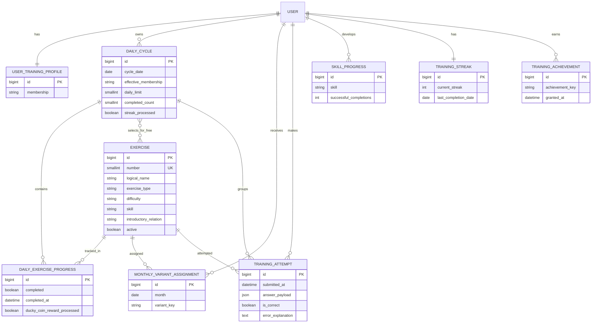

# ERD · Equipo 3 · DuckyTraining

> Diseño técnico de la Fase 3. No añade reglas funcionales fuera de `logica.md`.

## Borrado

- Datos dependientes del usuario: `CASCADE` al eliminar el usuario.
- Datos dependientes de `Exercise` y `DailyCycle`: `CASCADE`, porque en esta fase son registros internos de Training.
- Las reglas definitivas de retención, si otros equipos las requieren, quedan pendientes de contrato.

## Nota sobre usuarios

La guía PR07 propone una app `users` y un `CustomUser`. DuckyTraining no fija todavía ese contrato porque la especificación funcional asigna la identidad/autenticación definitiva a Equipo 0. Por tanto, se utiliza `AUTH_USER_MODEL` de Django como punto de integración y no se inventa un usuario definitivo.

## Reglas actualizadas 2026-10-07

- `UserTrainingProfile.membership` distingue FREE/PLUS/PRO; no representa el nivel general.
- `DailyCycle.selected_exercises` conserva la selección diaria aleatoria de FREE (3 juegos entre los números 1–6).
- PLUS/PRO acceden al catálogo completo de diez juegos sin bloqueo secuencial.
- `DailyExerciseProgress.ducky_coin_reward_processed` reserva el control idempotente de la Duki Coin diaria por juego; el envío real depende del contrato de Equipo 5.
- XP y nivel general no se gestionan directamente desde Training; la integración depende de Ecomotor/Equipo 0.
